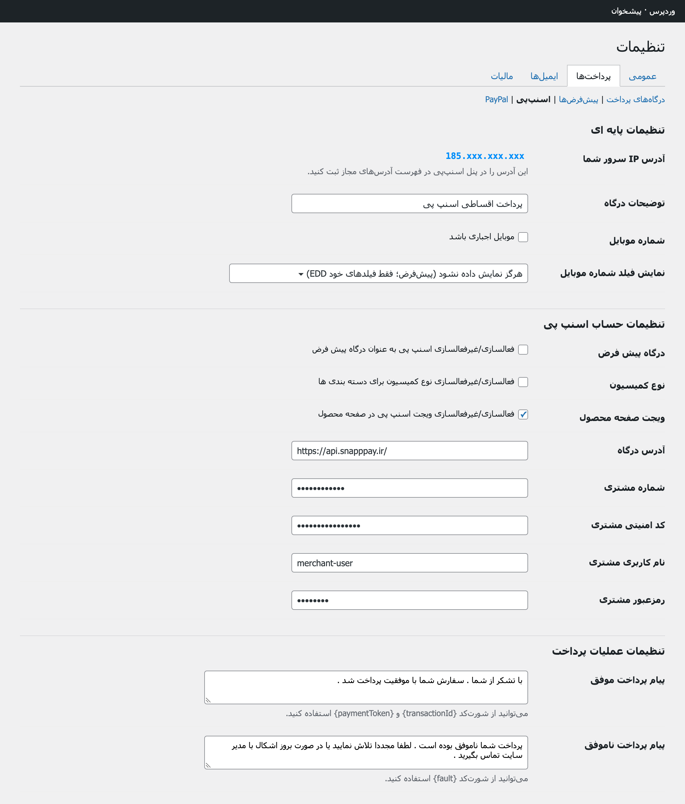
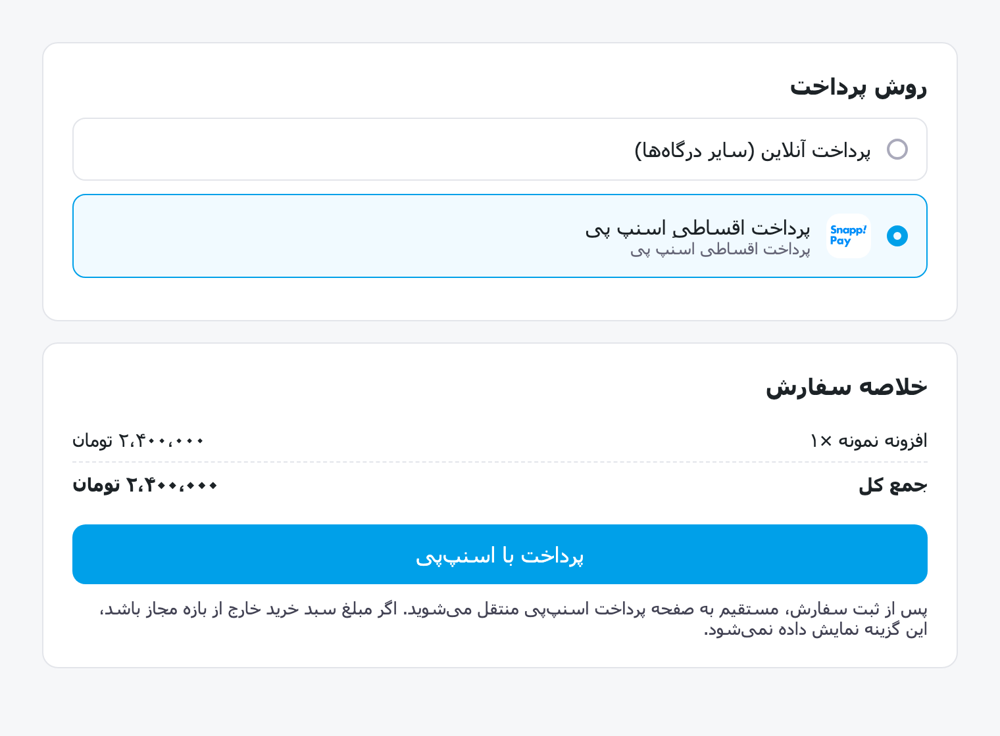

<div dir="rtl" align="right">

<p align="center">
  
</p>

<h1 align="center">درگاه پرداخت اقساطی اسنپ‌پی برای Easy Digital Downloads</h1>

<p align="center">
  
  
  
  
  
</p>

افزونه‌ای متن‌باز که روش پرداخت **اسنپ‌پی (SnappPay)** را به صفحه تسویه‌حساب [Easy Digital Downloads](https://easydigitaldownloads.com/) اضافه می‌کند تا مشتریان بتوانند محصولات دانلودی را **در ۴ قسط ماهانه، بدون سود، چک و ضامن** بخرند.

این افزونه از روی [افزونه رسمی ووکامرس اسنپ‌پی](https://snapppay.ir) برای EDD پورت شده است و عمداً پیشوندهای متفاوتی (`snapppay_edd_` / `SNAPP_PAY_EDD_`) دارد تا اگر هر دو افزونه روی یک سایت فعال بودند، تداخلی پیش نیاید.

---

## تصاویر

> تصاویر زیر نمونه‌هایی از رابط افزونه هستند که بر اساس فیلدها و متن‌های واقعی کد افزونه ساخته شده‌اند.

### تنظیمات درگاه در پیشخوان
مسیر: **دانلودها ← تنظیمات ← پرداخت‌ها ← درگاه‌های پرداخت ← اسنپ‌پی**



### انتخاب درگاه در صفحه تسویه‌حساب
اگر مبلغ سبد خرید در بازه مجاز اقساط اسنپ‌پی نباشد، درگاه به‌صورت خودکار از فهرست حذف می‌شود.



### ویجت مبلغ قسط در صفحه محصول (تم روشن و تیره)


---

## قابلیت‌ها

- افزودن اسنپ‌پی به فهرست روش‌های پرداخت EDD
- استعلام خودکار واجد شرایط بودن مبلغ سبد خرید و پنهان‌کردن درگاه در صورت خارج بودن از بازه مجاز
- **بدون افزودن فیلد اضافه به فرم تسویه‌حساب** (به‌صورت پیش‌فرض)؛ شماره موبایل از فیلد «شماره تماس» خود EDD خوانده می‌شود. فیلد اختیاری موبایل در صورت نیاز قابل فعال‌سازی است (هرگز / خودکار / همیشه)
- انتقال مستقیم کاربر به صفحه پرداخت اسنپ‌پی، بدون صفحه واسط
- تأیید (verify) و تسویه (settle) خودکار تراکنش پس از بازگشت از درگاه
- پیگیری خودکار ساعتی سفارش‌هایی که تأیید شده‌اند ولی تسویه نشده‌اند
- لغو خودکار تراکنش هنگام عودت یا ابطال سفارش
- اعلام اقلام و مبلغ نهایی به اسنپ‌پی هنگام تکمیل دستی سفارش توسط مدیر
- ویجت نمایش مبلغ هر قسط در صفحه محصول (تم روشن و تیره)
- فیلد «نوع کمیسیون» برای دسته‌بندی محصولات دانلودی
- پیام‌های قابل شخصی‌سازی برای پرداخت موفق، ناموفق و انصراف
- پشتیبانی از واحدهای پول ریال، تومان، هزار تومان و هزار ریال (تبدیل خودکار به ریال)
- نمایش خودکار آدرس IP سرور برای ثبت در پنل اسنپ‌پی

## پیش‌نیازها

| مورد | نسخه |
|---|---|
| وردپرس | ۵.۰ یا بالاتر |
| PHP | ۷.۴ یا بالاتر |
| Easy Digital Downloads | **۳.۰ یا بالاتر** (EDD 2.x پشتیبانی نمی‌شود) |
| حساب پذیرندگی اسنپ‌پی | فعال |

## نصب

۱. آخرین نسخه را دریافت کنید و پوشه `snapppay-edd-gateway` را در مسیر `wp-content/plugins/` قرار دهید:

```bash
cd wp-content/plugins
git clone https://github.com/hoomanjamshidi/EDD-Snapppay.git snapppay-edd-gateway
```

۲. از بخش «افزونه‌ها» در پیشخوان وردپرس، افزونه را فعال کنید.

۳. پس از فعال‌سازی، اعلانی حاوی **آدرس IP سرور** شما نمایش داده می‌شود. این آدرس را در پنل اسنپ‌پی در فهرست آدرس‌های مجاز ثبت کنید.

۴. به **دانلودها ← تنظیمات ← پرداخت‌ها ← درگاه‌های پرداخت** بروید و تیک «اسنپ‌پی» را بزنید.

۵. وارد زیربخش «اسنپ‌پی» شوید و اطلاعات حساب پذیرندگی را وارد کنید.

## تنظیمات

| تنظیم | توضیح |
|---|---|
| آدرس درگاه | پیش‌فرض: `https://api.snapppay.ir/` |
| شماره مشتری / کد امنیتی مشتری | `client_id` و `client_secret` از پنل اسنپ‌پی |
| نام کاربری / رمزعبور مشتری | اطلاعات کاربری حساب پذیرندگی |
| توضیحات درگاه | متنی که زیر نام درگاه در تسویه‌حساب نمایش داده می‌شود |
| موبایل اجباری باشد | شماره موبایل برای احراز هویت خریدار الزامی شود |
| نمایش فیلد شماره موبایل | `هرگز` (پیش‌فرض) / `خودکار` / `همیشه` |
| درگاه پیش‌فرض | اسنپ‌پی به‌عنوان درگاه پیش‌فرض انتخاب شود |
| نوع کمیسیون | فیلد نوع کمیسیون برای دسته‌بندی‌ها فعال شود |
| ویجت صفحه محصول / تم ویجت | نمایش مبلغ هر قسط زیر دکمه خرید؛ تم روشن یا تیره |
| پیام‌های پرداخت | متن موفق، ناموفق و انصراف (شورت‌کدها: `{transactionId}`، `{paymentToken}`، `{fault}`) |

> تنظیمات در آپشن `edd_settings` خود EDD ذخیره می‌شوند و کلید جداگانه‌ای در جدول options ندارند.

## جریان پرداخت

```
تسویه‌حساب ─► استعلام eligible ─► ثبت سفارش (pending) ─► دریافت توکن ─► انتقال به اسنپ‌پی
                                                                              │
   سفارش complete  ◄── settle ◄── verify ◄── بازگشت به سایت (edd-listener=snapppay)
```

- اگر `verify` موفق باشد ولی `settle` ناموفق، سفارش **عمداً در وضعیت «در انتظار» می‌ماند** تا محصول دانلودی پیش از قطعی‌شدن پول تحویل داده نشود. کرون ساعتی وضعیت را از اسنپ‌پی استعلام و سفارش را تعیین تکلیف می‌کند.
- جزئیات هر مرحله در یادداشت‌های سفارش ثبت می‌شود.

## سوالات متداول

**چرا اسنپ‌پی در صفحه تسویه‌حساب نمایش داده نمی‌شود؟**
۱) درگاه در «درگاه‌های پرداخت» تنظیمات EDD فعال نشده است. ۲) اطلاعات حساب وارد نشده یا نادرست است. ۳) مبلغ سبد خرید خارج از بازه مجاز اقساط اسنپ‌پی است.

**افزونه چه فیلدهایی به فرم تسویه‌حساب اضافه می‌کند؟**
به‌صورت پیش‌فرض هیچ فیلدی. اگر فروشگاه فیلد «شماره تماس» ندارد، گزینه «نمایش فیلد شماره موبایل» را روی «خودکار» یا «همیشه» بگذارید.

**سفارش در وضعیت «در انتظار» مانده است، چه کنم؟**
اگر پرداخت انجام شده ولی تسویه با خطا مواجه شده باشد، افزونه هر ساعت وضعیت را استعلام می‌کند. یادداشت‌های سفارش را بررسی کنید.

**واحد پول فروشگاه من تومان است، مشکلی پیش می‌آید؟**
خیر. مبالغ به‌صورت خودکار به ریال تبدیل می‌شوند.

## ساختار پروژه

```
index.php                          بوت‌استرپ: ثابت‌ها و بارگذاری فایل‌ها
functions.php                      توابع کمکی: تنظیمات، ارز، موبایل، وضعیت تراکنش، لاگ
class-snapppay-api.php             کلاس SnappPay_EDD_API: تنها لایه ارتباط HTTP با اسنپ‌پی
class-edd-gateway-snapppay.php     ثبت درگاه، تنظیمات، چک‌اوت، جریان پرداخت و کال‌بک
hooks.php                          چرخه عمر افزونه، اعلان‌ها، کرون، کمیسیون، ویجت محصول
assets/images/                     لوگوها
docs/images/                       تصاویر README
```

## برای توسعه‌دهندگان

**فیلترها:** `snapppay_edd_settings` · `snapppay_edd_settings_fields` · `snapppay_edd_render_mobile_field` · `snapppay_edd_order_currency` · `snapppay_edd_order_amount_in_rial` · `snapppay_edd_widget_logo` · `snapppay_edd_gateway_logo`

**اکشن:** `snapppay_edd_before_payment`

قراردادهای کدنویسی:

- کامنت‌ها و متن‌های رو به کاربر فارسی هستند.
- استاندارد WordPress Coding Standards (تورفتگی با tab، `array()`، شرط‌های Yoda).
- پیشوند `snapppay_edd_` برای توابع، `SnappPay_EDD_` برای کلاس‌ها و `SNAPP_PAY_EDD_` برای ثابت‌ها را حذف نکنید.
- تست خودکار وجود ندارد؛ تست به‌صورت دستی روی وردپرس + EDD 3.x با حساب پذیرندگی اسنپ‌پی انجام می‌شود.
- بررسی نحوی سریع:

```bash
find . -name '*.php' -exec php -l {} \;
```

### نکات امنیتی

بررسی گواهی SSL به‌صورت سراسری غیرفعال است (`https_ssl_verify` و `CURLOPT_SSL_VERIFY*`)، چون بسیاری از هاست‌های ایرانی گواهی به‌روز ندارند. پیش از استفاده در محیط تولید این موضوع را در نظر بگیرید.

## مشارکت

Issue و Pull Request خوش‌آمدند. لطفاً پیش از ارسال تغییر، قراردادهای کدنویسی بالا را رعایت کنید و روش تست خود را در توضیحات PR بنویسید.

## تاریخچه تغییرات

فهرست کامل در بخش `== تغییرات ==` فایل [readme.txt](readme.txt) آمده است.

## نویسنده

[هومان جمشیدی](https://Hoomanjamshidi.ir)

## سلب مسئولیت

«اسنپ‌پی» و لوگوی آن متعلق به شرکت مربوطه است و در این مخزن فقط برای شناسایی درگاه پرداخت استفاده شده است.

## مجوز

منتشرشده تحت مجوز [GPL v2 یا بالاتر](LICENSE).

</div>
